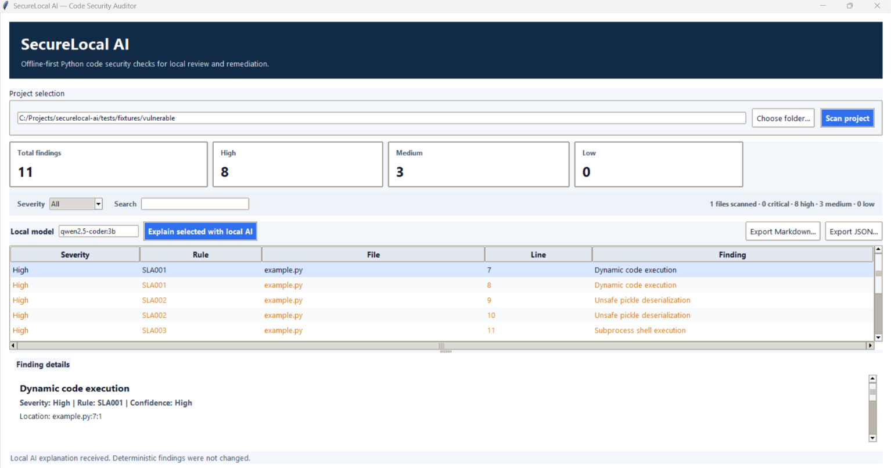
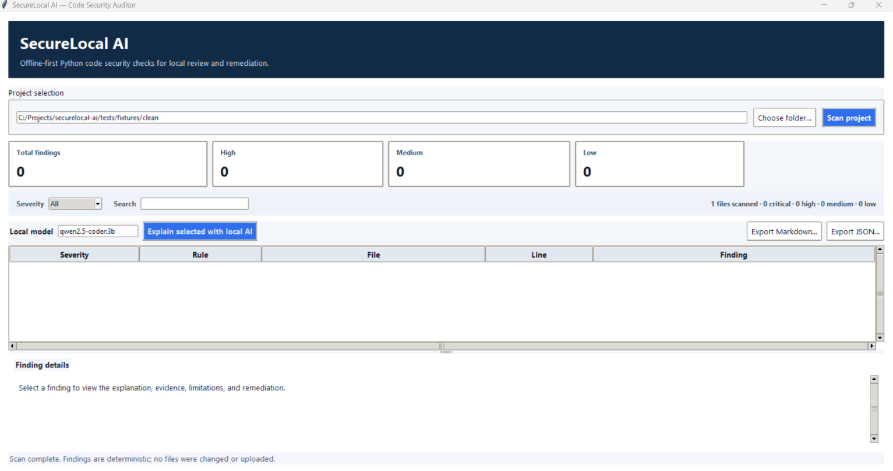
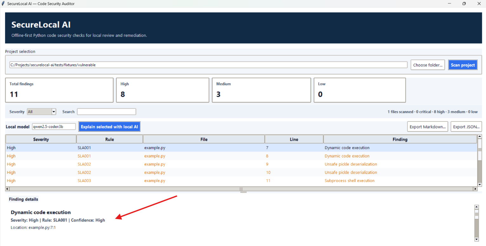
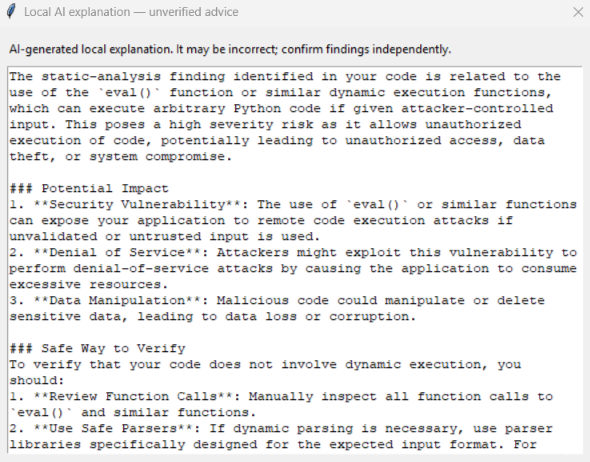

# SecureLocal AI

**An offline-first Python code security auditor and remediation assistant.**

SecureLocal AI is a desktop application that helps developers identify common security issues in Python source code without sending their source files to a cloud-based scanning service. It combines deterministic Abstract Syntax Tree (AST) analysis with optional, explicitly requested explanations from a locally running Ollama model.

> **Disclaimer:** SecureLocal AI is an early-stage, heuristic security scanner. A clean scan does not prove that code is secure, and this tool does not replace manual code review or a professional security audit.

## Screenshots

### 1. Vulnerability Scan

Displays detected security findings with rule IDs, severity levels, and source locations.



### 2. Clean Scan

Demonstrates the scanner's behavior on a clean test fixture.



### 3. Finding Details and Remediation

Shows finding evidence, explanations of potential risks, and recommended remediation steps.



### 4. Local AI Explanation

Uses a locally running Ollama model to provide additional context and remediation advice for a selected finding.



## Features

- **Static Python analysis:** Uses the standard library and AST-based rules to inspect source code without importing or executing the target code.
- **Seven security rules:** Detects potentially unsafe dynamic execution, insecure deserialization, risky shell execution, possible hardcoded credentials, weak hash algorithms, disabled HTTP TLS verification, and dynamically constructed SQL.
- **Redacted evidence:** Masks recognized credential-like assignments, token formats, authorization values, and credentials embedded in common service URLs.
- **Severity and filtering:** Presents findings with rule IDs, severity, locations, confidence, limitations, and remediation guidance, with severity and text filters in the desktop interface.
- **Local AI assistance:** Offers optional explanations using an Ollama model running on the same machine.
- **Report export:** Exports scan results to JSON and Markdown.
- **Resource limits:** Applies file-count, file-size, total-byte, and finding limits to help control scanning workloads.
- **Safer file discovery:** Skips common generated directories and symbolic links.
- **Asynchronous desktop interface:** Uses Tkinter to keep scanning and AI explanation tasks from unnecessarily blocking the interface.
- **No third-party Python dependencies:** The scanner, desktop interface, report exporters, and automated tests use Python's standard library.

## Technology Stack

| Component | Technology |
|---|---|
| Language | Python 3.11+ |
| Static analysis | Python AST |
| Desktop GUI | Tkinter |
| AI inference | Ollama with a locally installed model |
| Report formats | JSON and Markdown |
| Automated testing | `unittest` |
| External Python dependencies | None |

## Requirements and Setup

### Requirements

- Python 3.11 or newer.
- A working Tkinter installation.
- Windows is the primary documented setup environment.
- Ollama and a locally installed model are optional and required only for AI explanations.

### Run the application

Clone or download the repository and open a terminal in the project root.

Check your Python installation:

```powershell
python --version
```

Launch the desktop application:

```powershell
python app.py
```

No `pip install` step is required for the scanner, GUI, exports, or tests.

### Run a scan

1. Launch the application.
2. Select the project directory you want to inspect.
3. Choose **Scan project**.
4. Review the findings, severity levels, and remediation guidance.
5. Select a finding to inspect its details.
6. Export the results to JSON or Markdown if needed.

The current implementation scans Python (`.py`) files only.

### Run the automated tests

From the project root:

```powershell
python -m unittest discover -s tests -v
```

The current test suite contains **46 tests**, covering scanner behavior, security rules, redaction, report generation, Ollama client behavior, and GUI error handling.

To run a syntax compilation check:

```powershell
python -m compileall -q .
```

A successful compilation check produces no output.

### Run scanner smoke tests without the GUI

Scan the included synthetic fixtures directly:

```powershell
python -m scanner tests/fixtures/vulnerable
python -m scanner tests/fixtures/clean
```

These fixtures help demonstrate expected behavior; they are not a comprehensive security benchmark.

## Architecture

```text
securelocal-ai/
├── ai/                    Optional local Ollama client
├── scanner/               File discovery, AST rules, and scan engine
├── reports/               JSON and Markdown report exporters
├── ui/                    Tkinter interface and finding details
├── tests/                 Automated tests and synthetic fixtures
├── docs/
│   ├── SECURITY.md         Threat model and data-flow notes
│   └── screenshots/        Application screenshots
├── app.py                 Application entry point
└── README.md
```

The scanner is responsible for producing findings independently of the AI component. The optional model provides supplementary explanations only; it does not determine severity, alter scan results, apply patches, or execute code.

## Security Rules

| Rule ID | Detection | Important limitation |
|---|---|---|
| SLA001 | `eval()` and `exec()` | Does not establish whether the input is attacker-controlled. |
| SLA002 | `pickle.load()`, `pickle.loads()`, and `Unpickler.load()` | Risk depends on whether serialized input is untrusted. |
| SLA003 | `shell=True` in subprocess calls and dynamic `os.system`/`os.popen` use | Does not trace untrusted data into command arguments. |
| SLA004 | Credential-like variable names assigned non-placeholder string literals | Heuristic; may miss secrets or flag non-secret values. Recognized evidence is redacted. |
| SLA005 | MD5/SHA-1 hash calls | May flag legitimate non-security checksums. Password storage requires an appropriate password-hashing algorithm. |
| SLA006 | `verify=False` in recognized `requests`/`httpx` calls | Other HTTP clients and verification patterns may not be recognized. |
| SLA007 | SQL-looking text dynamically interpolated, formatted, or concatenated in execute calls | Cannot prove that input is untrusted or understand every database API. |

These rules provide an initial set of checks, not comprehensive Static Application Security Testing (SAST) coverage. Findings must be reviewed in context.

## Optional Local AI Explanations

SecureLocal AI can perform deterministic scans without Ollama. Local AI explanations are an optional enhancement.

### Setup

1. Install Ollama using its official installation instructions.
2. Ensure the Ollama service is running.
3. Download a model yourself if it is not already installed. For example:

   ```powershell
   ollama pull qwen2.5-coder:3b
   ```

   This command is an optional manual setup step. SecureLocal AI does not download models automatically.

4. Launch SecureLocal AI, select a finding, and choose **Explain selected with local AI**.

The default Ollama endpoint is:

```text
http://127.0.0.1:11434
```

The client restricts connections to the IPv4 loopback address `127.0.0.1` and rejects remote endpoints and redirects.

Only a limited, redacted finding context is sent to Ollama after the user explicitly requests an explanation. The application does not send the entire project or source file to the model.

AI-generated explanations are **unverified advice**. They can be incomplete, inaccurate, or unsuitable for the specific code and must be reviewed by a developer.

## Privacy and Threat Model

SecureLocal AI is designed to minimize unnecessary data exposure.

- **No cloud scanning:** Deterministic scanning does not make HTTP/API requests.
- **No target execution:** Scanned Python files are not imported or executed.
- **Local AI only:** AI requests are made only after explicit user action and target the local Ollama service.
- **Limited AI context:** The application sends minimal, redacted finding context rather than complete source files.
- **No automatic modification:** Scanning does not modify the source files, and the AI does not apply patches.
- **Controlled exports:** Reports are written to a user-selected output path and contain findings rather than full source files.

Operating-system file access can still involve network activity if a user selects a UNC or network-mounted directory. The safeguards also do not protect against a compromised operating system, malicious local software, Python runtime vulnerabilities, or accidental sharing of exported reports.

Read [docs/SECURITY.md](docs/SECURITY.md) for the detailed threat model and data-flow discussion.

## Limitations

- Supports Python source files only; it does not currently scan JavaScript, binaries, dependencies, or configuration files.
- Uses heuristic AST rules rather than full data-flow or interprocedural analysis.
- May produce false positives and false negatives.
- Resource limits can result in incomplete scans.
- Does not automatically fix vulnerabilities.
- Requires a working local Ollama service and installed model for AI explanations.
- AI output is not a verified security assessment.
- Automated tests use synthetic examples and mocked Ollama responses; passing tests does not establish real-world detection accuracy.

## Project Status

**Working prototype with automated tests and optional local AI assistance.**

The current implementation has a 46-test automated suite and has been manually exercised with local Ollama inference. These checks demonstrate functionality, not comprehensive security effectiveness.

Potential future improvements include additional reviewed detection rules, broader test corpora, structured finding suppression, accessibility improvements, and expanded language support.

## License

Add a license before distributing the project if you intend to make its reuse terms explicit.